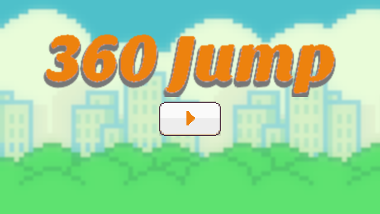
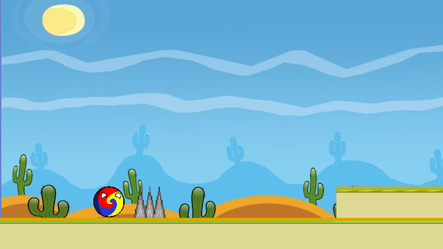

# 🎮 CumbiaBall

Juego de plataformas 2D hecho con [libGDX](https://libgdx.com/): controlas un balón que salta de plataforma en plataforma, esquiva pinchos y llega a la meta mientras suena música de cumbia. Tiene dos niveles y una pantalla de *game over* con reintento.





> ℹ️ El arte del menú todavía dice "360 Jump": es el nombre original de los recursos gráficos. Se puede cambiar cuando se renueven los assets.

---

## ✅ Requisitos

| Qué necesitas | Detalle |
|---|---|
| **Java** | **JDK 17 — Temurin recomendado** (probado con 17.0.21) |
| Rango soportado | Java 17 a 25 |
| Sistema | Windows, macOS, Linux o GitHub Codespaces |
| Gradle | No hace falta instalarlo: el repo trae el wrapper 9.9.1 |

> ⚠️ **Java 16 o anterior no sirve.** Gradle 9 exige JDK 17 como mínimo. Si ves un error de versión de clase o de Gradle, es exactamente eso.

### Stack actual

| Componente | Versión |
|---|---|
| Java | 17 |
| Gradle | 9.9.1 |
| libGDX | 1.14.2 |
| Backend de escritorio | LWJGL 3 (GLFW) |
| Física | Box2D |

---

## ☁️ Opción A — Jugar en GitHub Codespaces (sin instalar nada)

1. Entra al repo y pulsa **Code → Codespaces → Create codespace on master**.
2. Espera a que termine de construirse el contenedor (la primera vez tarda unos minutos: instala Java 17 y las librerías gráficas).
3. Abre la pestaña **Ports** (junto a la Terminal) y busca el puerto **6080 — Escritorio noVNC**. Pulsa el icono del globo para abrirlo.
4. Ingresa la contraseña: **`vscode`**.
5. En el escritorio remoto, abre una terminal (icono de terminal en la barra o clic derecho → *Open Terminal Here*) y ejecuta:

   ```bash
   ./scripts/run.sh
   ```

   El juego aparecerá en esa misma ventana remota.

> 💡 También puedes lanzarlo desde la terminal normal de VS Code: el contenedor ya trae `DISPLAY=:1`, así que la ventana se dibuja en el escritorio de noVNC.
>
> 🔇 En Codespaces no hay tarjeta de sonido. Verás avisos de ALSA y el juego seguirá funcionando sin sonido: es lo esperado.

---

## 💻 Opción B — Jugar en tu computador

### 1. Instala Java 17 (Temurin)

**Windows**

```powershell
winget install EclipseAdoptium.Temurin.17.JDK
```

**macOS** (con Homebrew)

```bash
brew install --cask temurin@17
```

**Linux (Debian/Ubuntu)** — descarga el `.tar.gz` de [Adoptium](https://adoptium.net/temurin/releases/?version=17), descomprímelo y apunta `JAVA_HOME` a esa carpeta.

**Cualquier sistema con [SDKMAN!](https://sdkman.io/)**

```bash
sdk env install     # lee .sdkmanrc y baja Temurin 17
sdk env             # activa esa versión en la sesión actual
```

Comprueba que quedó bien:

```bash
java -version
# openjdk version "17.0.x" ...
```

### 2. Clona el repositorio

```bash
git clone https://github.com/D4v1D-lab/CumbiaBall.git
cd CumbiaBall
```

### 3. Ejecuta el juego

**Linux / macOS**

```bash
./scripts/run.sh
```

**Windows**

```bat
scripts\run.bat
```

El script verifica tu versión de Java, avisa si algo no cuadra y arranca `./gradlew desktop:run`.

---

## 🕹️ Controles

| Acción | Cómo |
|---|---|
| Saltar | **Clic** o **toque** en cualquier parte de la pantalla |
| Saltar al aterrizar | Mantén pulsado mientras caes: el salto se ejecuta al tocar el suelo |
| Iniciar partida | Clic en el botón **play** del menú |
| Reintentar tras perder | Clic en el botón de la pantalla de *game over* |
| Salir | Cierra la ventana del juego |

Objetivo: avanzar por las plataformas sin tocar los pinchos y alcanzar la bandera de meta. Al superar el primer nivel pasas al segundo, con otra música.

---

## 🔧 Solución de problemas

**`Gradle requires JVM 17 or later to run` / `Unsupported class file major version`**
Tu `java` es más antiguo (o más nuevo) que el rango soportado. Instala Temurin 17 y confirma con `java -version`. Con SDKMAN: `sdk env`. El script `run.sh` lo detecta antes de arrancar Gradle y te dice qué versión tiene.

**`libXcursor.so.1: cannot open shared object file`**
Faltan librerías gráficas de X11 que usa GLFW. En Debian/Ubuntu:

```bash
sudo apt-get update && sudo apt-get install -y \
  libxcursor1 libxrandr2 libxxf86vm1 libxi6 libgl1-mesa-dri libopenal1 libgl1 mesa-utils
```

En Codespaces esto ya lo instala el `postCreateCommand` del devcontainer. Si acabas de cambiar el devcontainer, reconstruye el contenedor (*Command Palette → Codespaces: Rebuild Container*).

**`GLFW_FEATURE_UNAVAILABLE ... Wayland: The platform does not support setting the input focus`**
Aviso informativo en Wayland (habitual en WSLg): la ventana se abre y el juego funciona. Solo importa si la ventana no aparece.

**Pantalla en negro en noVNC / la ventana no aparece**
Confirma que el puerto **6080** está abierto y entra con la contraseña `vscode`; ejecuta el juego **dentro** del escritorio remoto. En Linux sin entorno gráfico no hay dónde dibujar: necesitas un servidor X (Xvfb, XWayland o noVNC).

**Avisos de ALSA / `Couldn't initialize audio`**
No hay tarjeta de sonido (Codespaces, contenedores, servidores). El juego se ejecuta igual, sin audio.

**Cambié de Java y sigue usando el viejo**
El daemon de Gradle conserva el JDK con el que se inició:

```bash
./gradlew --stop
./scripts/run.sh
```

**VS Code no reconoce Java 17**
El repo no fija rutas de JDK (para no romper en otras máquinas). Abre la paleta de comandos → **Java: Configure Java Runtime** y selecciona tu Temurin 17, o define `JAVA_HOME` antes de abrir VS Code.

---

## 📁 Estructura del proyecto

```
CumbiaBall/
├── core/                 Lógica del juego (pantallas, entidades, física Box2D)
├── desktop/              Launcher LWJGL 3 y tarea `run`
├── android/              Módulo Android heredado (fuera del build, ver LEEME.md)
├── assets/               Imágenes sueltas usadas por el módulo Android
├── docs/                 Capturas para el README
├── scripts/              run.sh (Linux/macOS/Codespaces) y run.bat (Windows)
├── .devcontainer/        Entorno reproducible de Codespaces
├── .github/workflows/    Compilación en Linux, Windows y macOS
├── .vscode/              Extensiones y configuración recomendadas
├── build.gradle          Configuración raíz y verificación del JDK
└── gradlew, gradlew.bat  Gradle Wrapper 9.9.1
```

> ℹ️ El módulo `desktop` toma las imágenes y sonidos de `android/assets`, por eso el `workingDir` de la tarea `run` apunta ahí. El módulo `android` está **excluido de `settings.gradle`** porque su AGP 3.5.4 es incompatible con Gradle 9; se reactivará cuando se migre a AGP 9.

---

## 🧩 Usar este proyecto como plantilla

Este repo es la base para nuevos juegos (por ejemplo, el de Sofi). Para arrancar uno:

1. Copia el repo y cambia `appName` y `gdxVersion` en `build.gradle`.
2. Renombra el paquete `com.mygdx.game` y actualiza `mainClassName` en `desktop/build.gradle`.
3. Sustituye los assets de `android/assets` (y su carpeta hermana `assets/`) por los nuevos.
4. Cambia el título en `DesktopLauncher.java` (`config.setTitle(...)`).
5. Ajusta el README y las capturas de `docs/`.

Todo lo demás — wrapper, verificación de JDK, scripts, devcontainer, CI y configuración de VS Code — ya viene resuelto.

---

## 🤝 Contribuir

1. Crea una rama: `git checkout -b mi-cambio`.
2. Haz tus cambios y pruébalos con `./scripts/run.sh`.
3. Abre un Pull Request describiendo qué cambiaste y cómo lo probaste.

Mantén las versiones del stack al día (Java 17, libGDX 1.14.x, Gradle 9.x): son la principal defensa contra la obsolescencia.

## 📄 Licencia

El repositorio no incluye un archivo de licencia. Si vas a reutilizar el código o los recursos, consulta antes con el autor.
